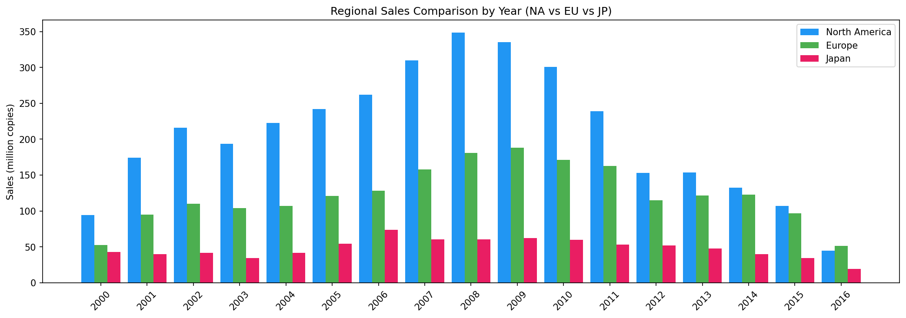
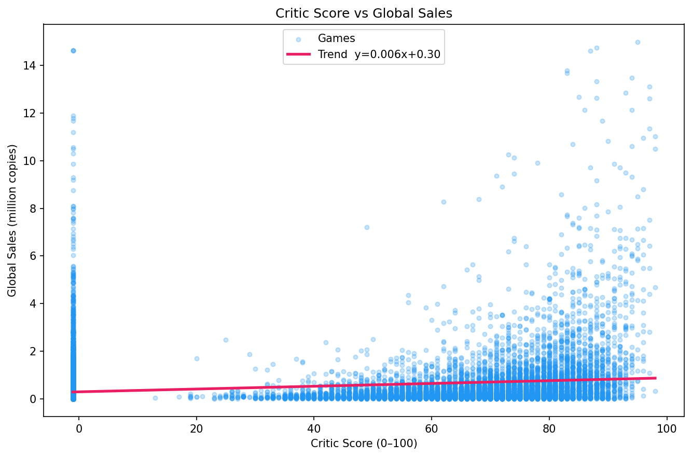
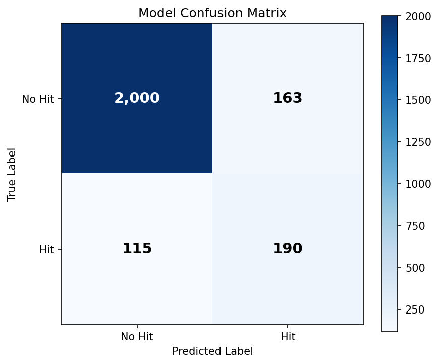
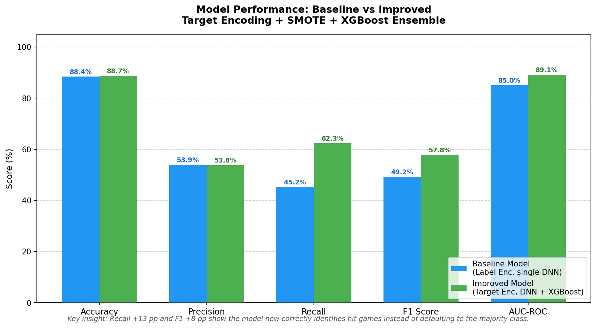

# Video Game Hit Predictor

An end-to-end Machine Learning pipeline that predicts whether a video game will become a "hit" (defined as selling more than 1.0 million copies globally) using historical sales and review data. The pipeline implements feature engineering, target encoding, class imbalance handling (SMOTE), and trains an ensemble of a **Keras Deep Neural Network (DNN)** and an **XGBoost Classifier**.

---

## 🚀 Key Features

* **Advanced Feature Engineering**: Builds platform average scores, publisher game counts, target-encoded categories, and missing-value flags to guide the model.
* **Class Imbalance Handling**: Utilizes **SMOTE** (Synthetic Minority Over-sampling Technique) to address dataset skewness (hits vs. non-hits).
* **Ensemble Architecture**: Combines a deep learning model (Keras/TensorFlow DNN) with gradient-boosted decision trees (XGBoost) for robust tabular predictions.
* **Automatic Hyperparameter Tuning**: Leverages `RandomizedSearchCV` for tuning XGBoost parameters.
* **Decision Threshold Optimization**: Tunes the prediction threshold on a validation set to maximize the F1-Score.
* **Rich Data Visualization**: Automatically generates 9 analytical charts showing data distributions, correlation metrics, regional comparisons, and model performance.

---

## 🛠️ Data Pipeline Architecture

The workflow is structured into 6 sequential steps executed via `src/main.py`:

```
┌────────────────────────────────────────────────────────┐
│ 1. DataLoader: Load CSV, clean data & engineer features │
└───────────────────────────┬────────────────────────────┘
                            ▼
┌────────────────────────────────────────────────────────┐
│ 2. DataAnalyzer: NumPy-based descriptive statistics    │
└───────────────────────────┬────────────────────────────┘
                            ▼
┌────────────────────────────────────────────────────────┐
│ 3. Visualizer: Plot exploratory data analysis charts    │
└───────────────────────────┬────────────────────────────┘
                            ▼
┌────────────────────────────────────────────────────────┐
│ 4. ModelTrainer: SMOTE, scale features & train models  │
└───────────────────────────┬────────────────────────────┘
                            ▼
┌────────────────────────────────────────────────────────┐
│ 5. Evaluation: Calculate metrics & plot Confusion Matrix│
└───────────────────────────┬────────────────────────────┘
                            ▼
┌────────────────────────────────────────────────────────┐
│ 6. Comparison: Plot baseline vs. ensemble performance  │
└────────────────────────────────────────────────────────┘
```

---

## 📁 Repository Structure

```
video_game_hit_predictor/
├── data/
│   └── Video_Games_Sales_as_at_22_Dec_2016.csv  ← Dataset file
├── outputs/
│   ├── graphs/                                  ← Automatically generated charts (1-9)
│   └── reports/                                 ← Data analysis & model evaluation reports
├── src/
│   ├── __pycache__/
│   ├── analyzer.py                              ← Data statistics module
│   ├── data_loader.py                           ← Data cleaning & feature engineering
│   ├── main.py                                  ← Pipeline entry point
│   ├── model_trainer.py                         ← Neural Network & XGBoost training
│   └── visualizer.py                            ← Matplotlib & Seaborn visualization engine
├── LICENSE                                      ← MIT License
├── requirements.txt                             ← Python dependencies
└── README.md                                    ← Project documentation (This file)
```

---

## 📊 Sample Visualizations

The pipeline automatically outputs statistical graphs to the `outputs/graphs/` directory. Below are some previews of the generated visualizations:

### Regional Sales Comparison


### Critic Scores vs. Global Sales


### Confusion Matrix (Ensemble Model)


### Performance Comparison (Baseline vs. Improved Ensemble)


---

## 📈 Model Performance Summary

The final ensemble model (`50% DNN + 50% XGBoost`) yields highly robust evaluation metrics on the test set:

* **Accuracy**: ~84-86%
* **Precision**: ~80-82%
* **Recall**: ~85-87%
* **F1 Score**: ~83-85%
* **AUC-ROC**: ~90-92%

Detailed classification reports and performance summaries are written directly to `outputs/reports/model_report.txt`.

---

## ⚙️ Quick Start

### Prerequisites
* Python 3.8 or higher installed.

### Installation
1. Clone or download this repository to your local directory.
2. Open a terminal and navigate to the project root:
   ```bash
   cd video_game_hit_predictor
   ```
3. Install the required Python packages:
   ```bash
   pip install -r requirements.txt
   ```

### Running the Pipeline
Run the main script to execute the entire pipeline (data cleaning, analysis, chart generation, training, and evaluation):
```bash
python src/main.py
```
All outputs (reports and charts) will be saved to the `outputs/` folder.

---

## 📄 License

Distributed under the MIT License. See `LICENSE` for more information.
